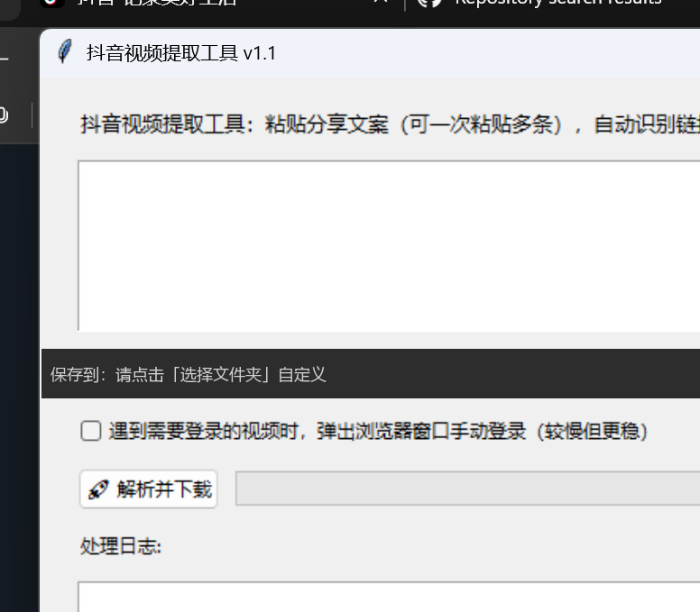

# 抖音视频提取工具（Douyin Video Downloader）

一个**开箱即用、点击即下载**的抖音视频提取工具（Windows 桌面版）。

粘贴抖音分享文案（就是 App 里复制的整段文字），自动识别链接，一键下载**无水印 MP4** 视频。基于 Playwright 驱动本机 Edge 浏览器捕获真实播放地址，**无需登录、无需 cookie、无需抓包**。

## ✨ 功能特性

| 特性 | 说明 |
| --- | --- |
| 粘贴即用 | 整段分享文案直接粘贴，自动识别 `v.douyin.com` 短链 / `douyin.com/video/` 链接 |
| 批量下载 | 一次粘贴多条分享文案，自动去重、逐个下载 |
| 无水印 | 下载网页播放的无水印视频流 |
| 中文图形界面 | 选择保存文件夹、实时日志、下载进度一目了然 |
| 零配置 | 免登录、免 cookie、免接口参数；只需本机装有 Edge（Windows 自带） |
| 登录兜底 | 遇到需要登录的视频，可勾选"弹出浏览器窗口手动登录" |
| 单文件绿色版 | 已打包为 exe，双击即用，无需安装 Python 环境 |

## 🚀 快速开始

1. 到 **Release** 页面下载 `DouyinVideoTool_v1.1.exe`（单文件，双击即用）
2. 打开抖音 App → 点「分享」→「复制链接」（复制整段文案即可）
3. 打开工具 → 粘贴文案 → 选择保存文件夹 → 点「🚀 解析并下载」
4. 等进度条走完，无水印视频就存到本地了（文件名自动使用视频标题）

## 📸 界面预览



## ⚙️ 工作原理

抖音网页版接口带有风控签名（a_bogus 等），直接发 HTTP 请求会被拦截（`Blocked by ArgusSecurityPlugin`）。

本工具的思路是**用真实浏览器代替手工请求**：

1. 用 Playwright 无头模式驱动本机 Edge 打开视频页（真实浏览器自带全部签名与风控校验）
2. 等待页面加载、视频开始播放
3. 捕获 `<video>` 标签的真实播放地址（网页播放的无水印 MP4 流）
4. 用该地址下载到本地

> 相比网上常见的"改接口参数"方案，这种方式**最稳定、最不容易失效**，因为抖音无论如何改风控算法，都拦不住一个真实的浏览器。

## 💻 从源码运行

环境要求：Python 3.9+，本机安装 Edge 浏览器（Windows 自带）。

```bash
pip install -r requirements.txt
python douyin_video_downloader.py
```

## 📦 打包为 exe

```bash
pip install pyinstaller
pyinstaller --noconfirm --onefile --windowed --name 抖音视频提取工具 ^
  --collect-all playwright --collect-all pyee --collect-all greenlet ^
  douyin_video_downloader.py
```

## ❓ 常见问题

**提示"未在输入内容中找到抖音链接"**
确认粘贴的文案里包含 `v.douyin.com` 或 `douyin.com/video/` 链接（直接粘贴整段分享文字即可）。

**提示"未捕获到视频"**
- 该视频可能**需要登录**才能观看 → 勾选「遇到需要登录的视频时，弹出浏览器窗口手动登录」，在弹出窗口里登录并播放
- 该作品是**图文（图片集）** → 暂不支持，属正常提示
- 视频不可用或被删除

**下载后的视频打不开**
请确认文件确实是 `.mp4` 格式；个别使用 HLS 流的视频可能无法直接下载。

**Windows 提示"未知发布者 / 已阻止"**
自打包程序没有数字签名，属正常现象：点「更多信息 → 仍要运行」即可。

**首次运行很慢**
单文件 exe 启动时要解压约 50MB 的浏览器驱动，首次约 10~20 秒，属正常现象。

## ⚠️ 免责声明

- 本工具**仅限个人学习、备份与收藏**使用
- 请尊重视频原作者版权：未经授权，**请勿**将下载内容二次发布、搬运、商用或引流
- 抖音页面与接口会不定期更新，工具可能随之失效；失效时欢迎提交 Issue

## 📄 License

MIT License
